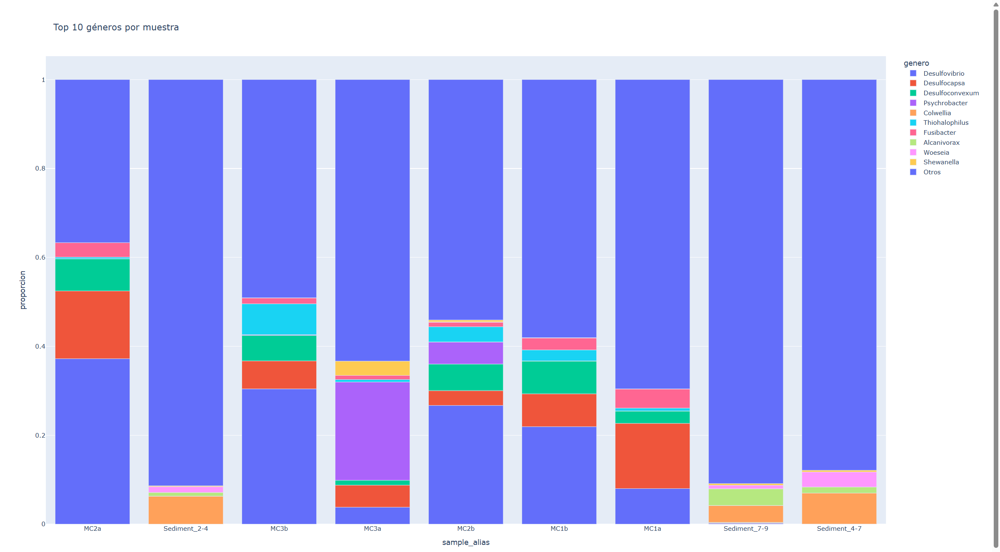
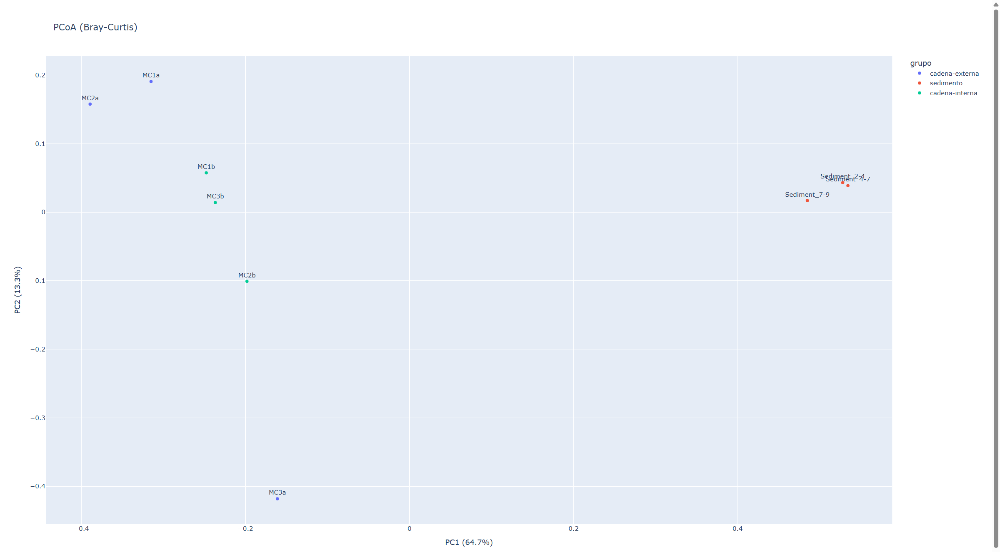
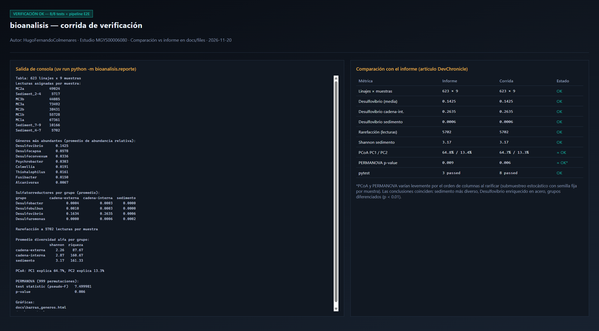

# EpiBio

Pipeline reproducible en Python para comparar comunidades microbianas (abundancias 16S) entre acero corroído en el fondo marino y sedimento circundante, usando datos públicos de [MGnify](https://www.ebi.ac.uk/metagenomics/) y la [ENA](https://www.ebi.ac.uk/ena/).

**Autor:** [HugoFernandoColmenares](https://github.com/HugoFernandoColmenares)

Estudio de referencia: Rajala et al., *Microbiome* (2022) — [MGYS00006080](https://www.ebi.ac.uk/metagenomics/studies/MGYS00006080) / [PRJNA693108](https://www.ebi.ac.uk/ena/browser/view/PRJNA693108).

---

## Qué hace

1. Descarga sin clave la tabla SSU de MGnify y los metadatos de amplicón de la ENA.
2. Parte el linaje taxonómico, agrupa por género y calcula abundancias relativas.
3. Aplica rarefacción, diversidad alfa/beta (Bray-Curtis), PCoA y PERMANOVA con scikit-bio.
4. Genera gráficas HTML interactivas (plotly) y un resumen en consola.

Arquitectura detallada: [`docs/files/arquitectura_epibio.md`](docs/files/arquitectura_epibio.md).  
Verificación E2E (números vs informe + capturas): [`docs/files/verificacion_e2e.md`](docs/files/verificacion_e2e.md).

---

## Capturas de verificación

Corrida del 2026-11-20: **8 tests OK** y pipeline completo con resultados alineados al informe en `docs/files/`. Detalle en [`verificacion_e2e.md`](docs/files/verificacion_e2e.md).

**Top 10 géneros** — *Desulfovibrio* dominante en cadenas; sedimento con poco del top:



**PCoA (Bray-Curtis)** — PC1 (~64.7%) separa sedimento de cadena:



**Consola + comparación métrica** vs el artículo:



---

## Requisitos

- [uv](https://docs.astral.sh/uv/) (gestor de paquetes y entornos)
- Python 3.14+ (uv lo descarga si hace falta)
- Conexión a internet para la primera descarga de datos

---

## Instalación

```sh
uv sync
```

Esto crea `.venv/`, instala dependencias desde `pyproject.toml` y genera/usa `uv.lock`.

---

## Uso

Descargar datos (opcional; el reporte lo hace si faltan):

```sh
uv run python -m epibio.descarga
```

Correr el análisis completo:

```sh
uv run epibio
# o
uv run python -m epibio.reporte
```

Salidas:

- Resumen en consola (lecturas, géneros, alfa, PCoA, PERMANOVA)
- `docs/barras_generos.html`
- `docs/pcoa.html`

Pruebas:

```sh
uv run pytest -q
```

---

## Estructura

```text
src/epibio/
  descarga.py     # MGnify + ENA
  taxonomia.py    # linaje, agrupación, normalización
  diversidad.py   # rarefacción, alfa/beta, PCoA, PERMANOVA
  graficas.py     # plotly → HTML
  reporte.py      # orquestación CLI
tests/
docs/
  files/          # especificación, artículo, arquitectura, verificación E2E
  screenshots/    # capturas de la corrida verificada
  barras_generos.html / pcoa.html
data/raw/         # TSV descargados (gitignored)
```

---

## Principios

- **SRP:** un módulo, una responsabilidad.
- **DRY / KISS:** funciones puras; `partir_linaje` es la única fuente del parsing.
- **Reproducibilidad:** semilla fija (`SEMILLA = 42`) y bitácora `DESCARGAS.txt`.

---

## Atribución y datos

Los datos pertenecen a EMBL-EBI y a los autores del estudio original. Al usarlos, cite:

> Rajala P, Cheng DQ, Rice SA, Lauro FM. *Sulfate-dependant microbially induced corrosion of mild steel in the deep sea: a 10-year microbiome study.* Microbiome 10, 4 (2022). [doi:10.1186/s40168-021-01196-6](https://doi.org/10.1186/s40168-021-01196-6)

Términos de uso: [EMBL-EBI Terms of Use](https://www.ebi.ac.uk/about/terms-of-use/).

---

## Licencia

[MIT](LICENSE) © [HugoFernandoColmenares](https://github.com/HugoFernandoColmenares)
