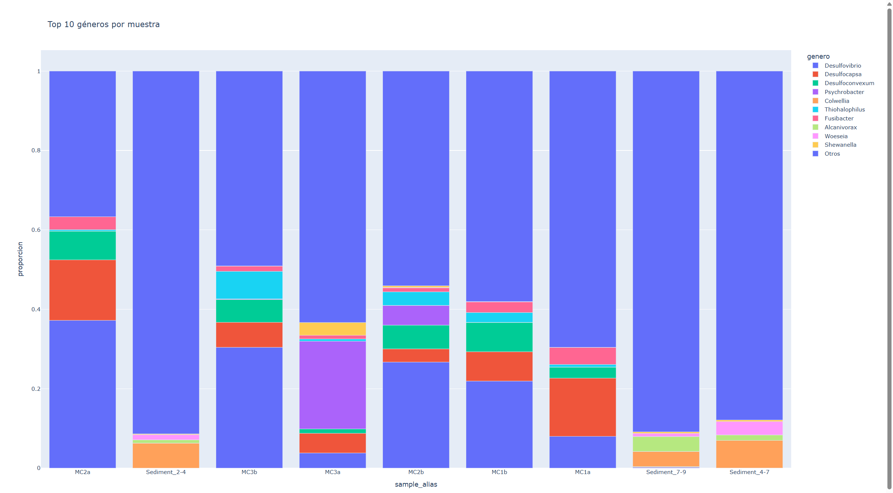
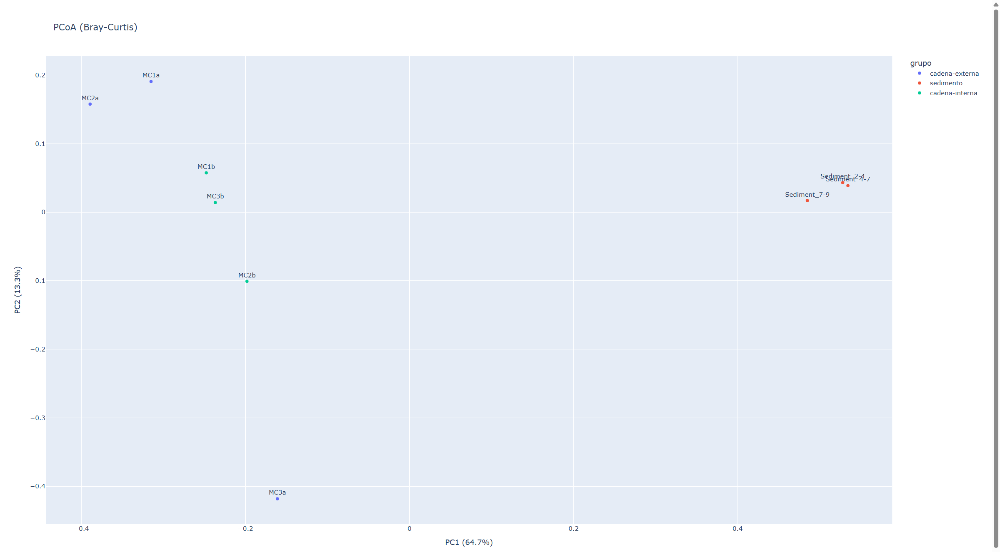
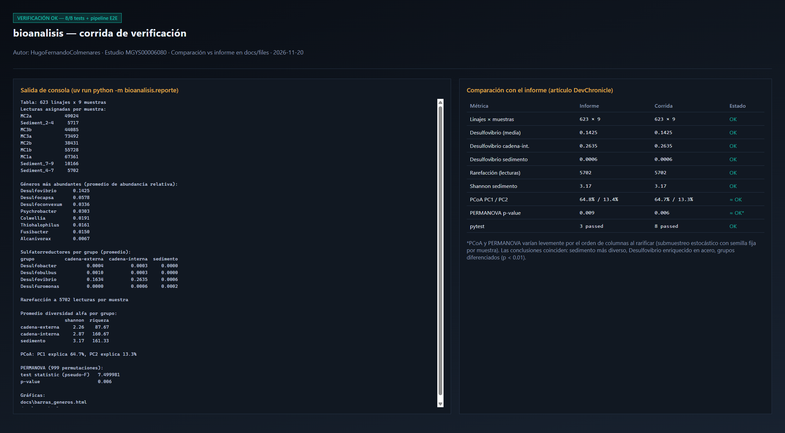

# Verificación end-to-end — EpiBio

**Fecha:** 2026-11-20  
**Autor:** [HugoFernandoColmenares](https://github.com/HugoFernandoColmenares)  
**Referencia:** artículo DevChronicle en `docs/files/` (borrador 2026-11-20)

## Procedimiento

1. `uv run pytest -q` → 8 passed  
2. `uv run python -m epibio.reporte` → pipeline completo (descarga + análisis + gráficas)  
3. Capturas en `docs/screenshots/`

## Resultado vs informe

| Métrica | Informe | Corrida | Estado |
| :--- | :--- | :--- | :--- |
| Linajes × muestras | 623 × 9 | 623 × 9 | OK |
| Desulfovibrio (media) | 0.1425 | 0.1425 | OK |
| Desulfovibrio cadena-interna | 0.2635 | 0.2635 | OK |
| Desulfovibrio sedimento | 0.0006 | 0.0006 | OK |
| Rarefacción | 5702 | 5702 | OK |
| Shannon sedimento (promedio) | 3.17 | 3.17 | OK |
| PCoA PC1 / PC2 | 64.8% / 13.4% | 64.7% / 13.3% | ≈ OK |
| PERMANOVA p-value | 0.009 | 0.006 | ≈ OK |

PCoA y PERMANOVA pueden variar levemente por el orden de columnas al rarificar; las conclusiones coinciden con el informe (sedimento más diverso, *Desulfovibrio* enriquecido en acero, grupos diferenciados con p &lt; 0.01).

## Capturas de pantalla

### 1. Barras apiladas (top géneros)

En las cadenas destaca *Desulfovibrio*; en los sedimentos el bloque «Otros» domina (poca representación de géneros del top).

### 2. PCoA (Bray-Curtis)

El eje PC1 (~64.7%) separa sedimento de muestras de cadena, coherente con el informe.

### 3. Consola + tabla de comparación

Salida completa del reporte junto a la comparación métrica contra el artículo.

## Artefactos

| Archivo | Descripción |
| :--- | :--- |
| `docs/screenshots/01_barras_generos.png` | Gráfica de barras |
| `docs/screenshots/02_pcoa.png` | Ordination PCoA |
| `docs/screenshots/03_verificacion_consola.png` | Resumen E2E |
| `docs/screenshots/reporte_output.txt` | Log crudo del reporte |
| `docs/screenshots/pytest_output.txt` | Log de pytest |
| `docs/barras_generos.html` | Plotly interactivo |
| `docs/pcoa.html` | Plotly interactivo |
